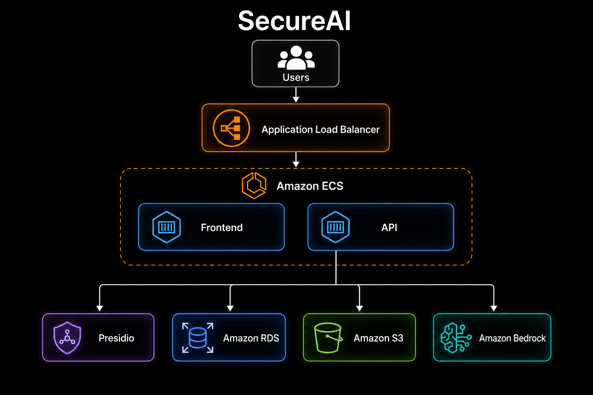

# SecureAI

Workspace RAG com anonimização de PII (Presidio PT) antes de S3 / Bedrock.



## Stack

| Camada | Tecnologia |
|--------|------------|
| API | FastAPI, SQLAlchemy 2, Alembic |
| Front | React, Vite, TypeScript |
| Dados | Postgres |
| PII | Presidio Analyzer (pt) |
| Cloud | S3, Bedrock Managed Knowledge Base |

## Estrutura

```text
secure-ai/
├── docker-compose.yml   # Postgres + Presidio
├── presidio/            # Analyzer custom (CPF/CNPJ, spaCy pt)
├── backend/             # API FastAPI
└── frontend/            # React + Vite
```

## Setup local

### 1. Infra local

```bash
docker compose up -d --build db presidio-analyzer
```

- Postgres: `localhost:5435`
- Presidio: http://127.0.0.1:5003/health

### 2. Backend

```bash
cd backend
uv sync --extra dev
cp .env.example .env
uv run alembic upgrade head
uv run uvicorn app.main:app --reload --port 8000
```

- API: http://127.0.0.1:8000/docs
- Health: http://127.0.0.1:8000/api/v1/health

```bash
uv run pytest
```

### 3. Frontend

```bash
cd frontend
npm install
cp .env.example .env
npm run dev
```

App: http://localhost:5173  
API base: `VITE_API_BASE_URL` (ex.: `http://localhost:8000/api/v1`)

## Fluxo

1. **Upload** — texto/PDF → Presidio → tokens `{{PII_*}}` + vault → S3 → sync KB  
2. **Chat** — pergunta anonimizada → Bedrock → resposta + fontes  

Fora de escopo: auth, políticas de bloqueio, streaming no front, observabilidade.
