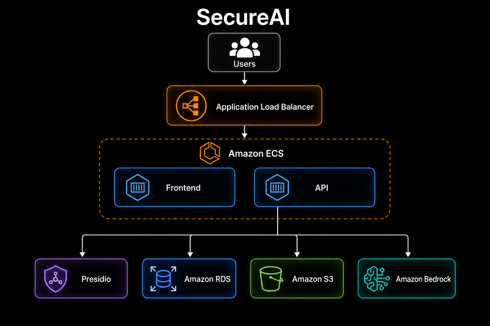

# SecureAI — arquitetura

Camada de segurança entre o usuário e o LLM: documentos e perguntas passam por PII
(Presidio) antes de ir para S3 / Bedrock.

## Ambientes

**Local (híbrido):** API e front na máquina; Postgres + Presidio no Docker; S3 e Bedrock na AWS.

**Prod (alvo):** ALB → ECS (Frontend + API + Presidio) → RDS, S3 e Bedrock.

Infra Terraform: `infra/` (`dev` e `prod`). Ver [`infra/README.md`](../infra/README.md).

## Fluxos

- **Upload** (texto/PDF): extrai texto → Presidio → tokens `{{PII_*}}` → S3 → sync da Knowledge Base
- **Chat**: pergunta anonimizada → Bedrock (Managed KB) → resposta + fontes → audit
- **Vault**: mapeia token → valor original (sem rehidratação no produto)
- **Observabilidade:** eventos de upload/chat/sync + dashboard

## Fora de escopo

- Auth / permissões
- Políticas de bloqueio
- Streaming no front
